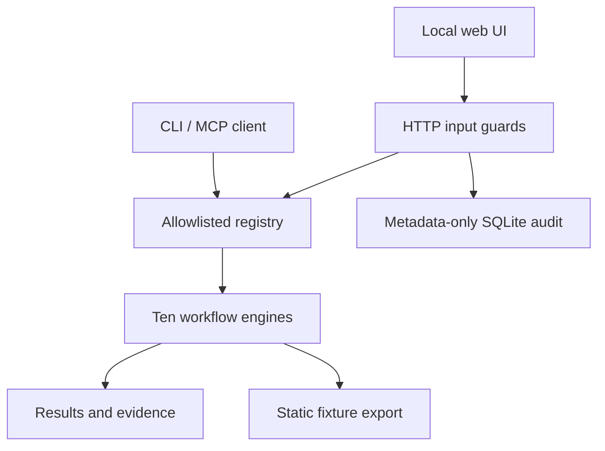

# Architecture and delivery decisions

The same bounded Python engines power CLI runs, local HTTP requests, MCP tool calls and recorded fixture exports. The UI renders computed evidence rather than making domain decisions in browser code.

## Decisions

| Decision | Reason | Tradeoff |
|---|---|---|
| Python standard library | Reviewer can run immediately, offline, without package installation | A real deployment needs a production server and richer infrastructure |
| Independent domain modules | Every project has a specific behavior and isolated tests | Some validators are duplicated intentionally for readability |
| Shared execution contract | One interface, trace format and tool boundary | Global size limits may be stricter than a module's direct-call limits |
| Synthetic data only | Public portfolio contains no customer secrets | Does not demonstrate actual customer adoption or real-world data quality |
| Deterministic engines | Repeatable failures and inspectable decisions | No implicit claim of model intelligence; models may call tools through MCP |
| SQLite for webhook state | Transactions, deduplication and restart behavior are real | The external delivery endpoint is simulated; not a distributed exactly-once system |
| Static recorded examples | Source host can present evidence without a backend | Edited inputs require the local Python server |

## API

| Method | Route | Contract |
|---|---|---|
| GET | `/api/health` | Local demo status |
| GET | `/api/projects` | `{projects: [SPEC]}` |
| GET | `/api/projects/<id>` | `{project: SPEC, sample: object}` |
| POST | `/api/run/<id>` | JSON input -> `{run_id, project_id, result, elapsed_ms, input_sha256}` |
| GET | `/api/runs` | Last 30 audit metadata records; no input or result content |

Inputs are bounded to 1 MiB, 24 nesting levels and 500 items per array/object. Non-finite values and duplicate JSON keys are rejected. Project IDs come from a fixed allowlist. HTTP requests require the exact loopback Host; supplied Origin must be same-origin. POST requires `application/json`. The server never fetches a submitted URL or shells out.

ProofDesk's supplied tenant/roles and ACLs are **scenario data**, not authentication. MCP is a trusted local subprocess and has no remote authentication layer. The browser API is not exposed externally. `FIELDKIT_ENV` values other than `local` refuse server creation.

## Path to a real customer deployment

1. Agree on workflow, owners, data access, ground-truth examples and acceptance criteria.
2. Implement one trusted source adapter plus authenticated server-side identity/tenant policies.
3. Add production serving, durable migrations/backups, secret management, telemetry, request budgets and operational ownership.
4. Run representative, adversarial and load tests; shadow existing work with human review.
5. Validate adoption and workflow outcomes before enabling write actions. Document rollback and handoff.

Those steps are a backlog, not completed deployment claims.
