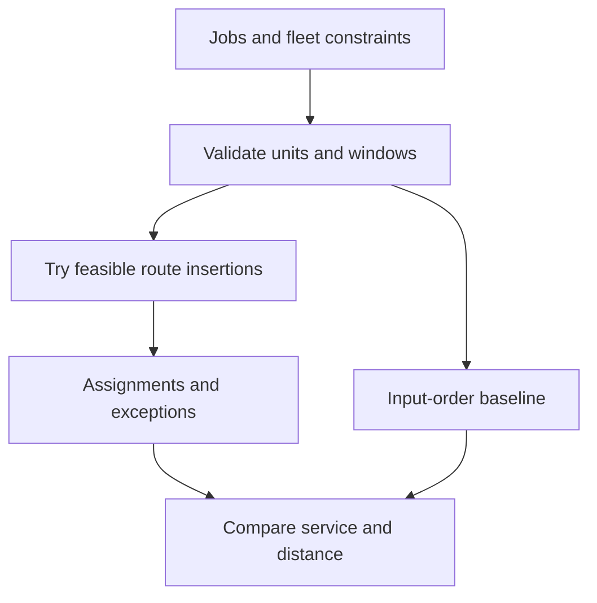

# RouteCraft — feasible dispatch with honest exceptions

**Customer:** a regional distributor operating a small delivery fleet. **Business problem:** a route that appears short can still violate delivery promises, overload a van or leave a driver too far from the depot at shift end.

This project computes delivery assignments from coordinates and constraints, compares them with a simple baseline, and explains rejected jobs. It uses synthetic planar geometry; it does not claim road distances, map routing, live traffic or optimal vehicle routing.

## What the working slice does

Jobs are ordered by service-completion deadline. For every job, the planner tries each insertion position on each vehicle, simulates arrival/wait/service/depot-return times, rejects infeasible routes, and chooses the smallest added distance among feasible insertions. Capacity is the sum of outbound delivery quantities. Each job is assigned at most once.



The baseline appends jobs in input order to the first feasible vehicle. The output shows assigned-count and distance differences. Distance is marked comparable only when both methods serve the exact same set of jobs; matching counts alone is insufficient. The heuristic can underperform other approaches; there is no optimality claim.

## Run it

From the repository root:

```python
from fieldkit.projects.routecraft import SAMPLE, run
result = run(SAMPLE)
print(result["summary"])
print(result["routes"])
print(result["unassigned"])
```

Each vehicle accepts `id`, `capacity`, `shift_start`, `shift_end`, and `speed_units_per_minute`. Each job accepts `id`, `[x,y]` location, `demand`, `window_start`, `window_end`, and `service_minutes`. Times are elapsed minutes from a shared planning origin. The window ends when service must be **complete**, not merely started.

The synthetic fixture has two vans and six requests. Four fit. A quantity-12 wholesaler exceeds every van's capacity, while a distant kiosk cannot satisfy its deadline. Unassigned output distinguishes intrinsic infeasibility from a job that would fit alone but cannot be inserted around fleet commitments.

## A 90-second customer demo

1. **0–25 seconds:** run the fixture and show the ordered stops, arrival times, waits and depot-return times.
2. **25–45 seconds:** inspect the wholesaler rejection; reduce demand from 12 to 1 and re-run to see whether fleet commitments now permit insertion.
3. **45–65 seconds:** shorten a vehicle's shift. The engine must reject a route whose final delivery fits but whose return to the depot does not.
4. **65–90 seconds:** compare against the baseline. Discuss both deliveries served and distance; show the `distance_comparable` flag.

## Acceptance evidence

```text
python -m unittest discover -s tests -p "test_routecraft.py" -v
```

Tests independently check 3-4-5 geometry, service time and depot return, completion windows, total capacity, early-arrival waiting, recovery of an input-order deadline failure, empty jobs, invalid data, unique assignment and impossible-job reasons. The fixture calculations establish engine behavior, not real delivery savings.

## Deployment conversation

Discovery questions: Are deliveries splittable? Does the customer promise arrival or service completion? Can a vehicle reload? Which traffic estimates and vehicle restrictions are authoritative? What is the business penalty for a missed order versus extra distance?

Production work includes address quality/geocoding, an approved travel-time matrix, dispatcher overrides, driver telemetry, a stronger solver, uncertainty buffers and historical replay against the customer's manual plans. The current engine has one depot, one trip per vehicle, no pickup loads, no traffic and no stochastic service durations. Up to 20 vehicles and 80 jobs are accepted for a bounded demonstration.

**Commercial hypothesis:** provide dispatch onboarding and an exception-review tool to local distributors. Evaluate completion rate, dispatcher correction time and distance for equivalent order sets before claiming savings or selling outcome-based pricing.
