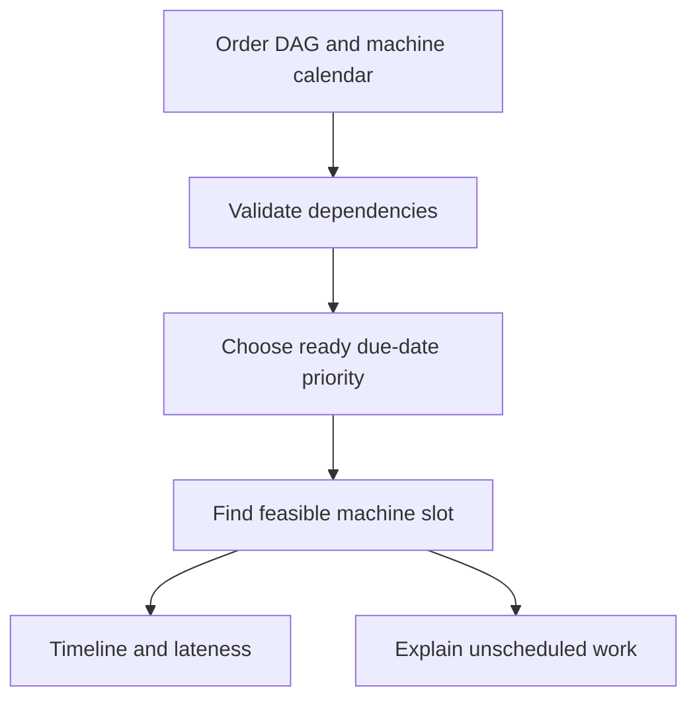

# ShiftForge — a feasible manufacturing shift

**Customer:** a small manufacturer coordinating customer deadlines, machine skills and maintenance. **Business problem:** a spreadsheet can double-book a machine, ignore a predecessor operation or promise work that has no qualified machine.

This project turns a synthetic order graph into a feasible, auditable schedule. It reports lateness and rejected work instead of silently hiding impossible orders. It is a deterministic list scheduler, not a globally optimal production-planning system.

## What the working slice does

The engine validates job dependencies, rejects cycles and unknown predecessors, then schedules ready jobs by earliest due date. It chooses the qualified machine that can complete a job first, accounting for release time, completed dependencies, machine availability and non-preemptive maintenance conflicts. The planning horizon is a hard bound. A rejected predecessor explicitly blocks its descendants.



Output includes job start/end times, machine load, maintenance-adjusted capacity, utilization and bottleneck candidates. Utilization indicates a review candidate; it does not prove that adding that machine would improve throughput. Scheduling is append-only on each machine and can leave usable earlier gaps.

## Run it

From the repository root:

```python
from fieldkit.projects.shiftforge import SAMPLE, run
result = run(SAMPLE)
print(result["summary"])
print(result["records"])
print(result["unscheduled"])
```

Each machine has `id`, a `skills` list, optional `available_from`, and optional `unavailable` intervals with `start` and `end`. Each job has `id`, `skill`, `duration_minutes`, optional `release_minute`, `due_minute`, and `depends_on`. All times are minutes from one shift origin.

The synthetic fixture contains seven jobs and three machines. Six are scheduled. A coating job has no qualified machine. A cutting job must wait until maintenance ends, which propagates downstream timing and makes certain customer deadlines visibly late.

## A 90-second customer demo

1. **0–25 seconds:** run the fixture and inspect the cut → mill → assemble sequence. Predecessor completion must precede the next operation.
2. **25–45 seconds:** inspect the laser maintenance interval from minute 60 to 90. Show why a non-preemptive operation cannot straddle it.
3. **45–65 seconds:** add a machine with the `coat` skill. Re-run and see the missing-skill exception become a scheduled job.
4. **65–90 seconds:** shorten the horizon or introduce a dependency cycle. The former creates explained unscheduled work; the latter is rejected as invalid input.

## Acceptance evidence

```text
python -m unittest discover -s tests -p "test_shiftforge.py" -v
```

Tests check non-overlap on each machine, dependency completion, maintenance boundaries, release and availability times, lateness arithmetic, missing-skill propagation, hard horizon limits, cycle/unknown-dependency rejection, invalid durations, overlapping maintenance and empty-job behavior. Fixture results are synthetic; no factory throughput improvement is claimed.

## Deployment conversation

Discovery questions: Which system owns the order routing? Can operations pause? Are setup times sequence-dependent? Is labor shared between machines? Are materials already available? Which deadlines may move, and who approves the change?

A deployment needs ERP/MES connectors, real shift calendars, setup and transfer times, labor/material constraints, planner overrides, change tracking and historical replay against approved plans. Current jobs require one machine at a time, have fixed durations and cannot be interrupted. It accepts at most 50 machines, 200 jobs and 100 maintenance windows per machine. The due-date heuristic is feasible but may idle equipment unnecessarily and does not minimize total lateness.

**Commercial hypothesis:** a planning pilot and integration package for a manufacturer still coordinating work manually. Measure infeasible commitments detected, planner override rate and schedule adherence before claiming capacity gains.
