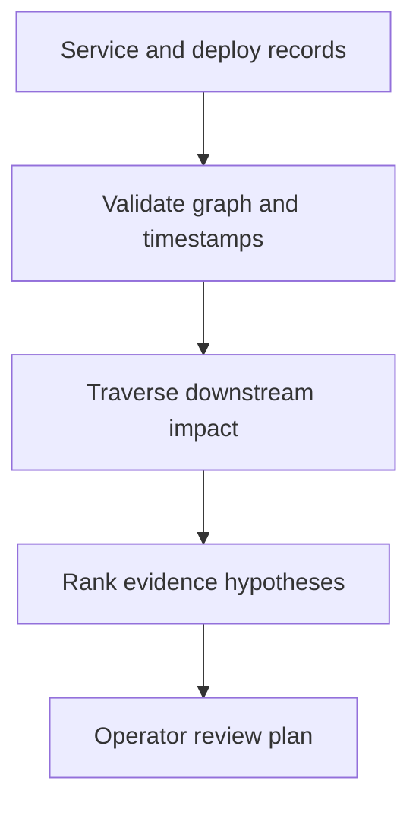

# Switchboard — incident hypothesis workbench

**Customer:** the on-call team at a SaaS business with a growing service graph. **Business problem:** multiple alerts arrive at once, but changing the loudest service can make the incident worse. The operator needs a reviewable explanation of shared dependencies before choosing a response.

This project is a deterministic incident-analysis engine. It computes blast radius and ranks hypotheses from supplied evidence. It does not connect to a monitoring account, infer causality, use an LLM or execute changes.

## What the working slice does

The input contains service dependencies, current error percentages, traffic, deployment timestamps and an explicit analysis time. Reverse-graph traversal identifies downstream consumers for each alerting service. A visible heuristic combines observed errors, corroborating downstream alerts, recent deploys and unhealthy dependencies. The result contains the evidence, graph and a review-only response plan. Cyclic dependencies terminate safely and are surfaced as warnings.



The score is `max(0, error percentage + 5 × alerting downstream count + 10 if a recent deploy exists − 8 × unhealthy dependency count)`. It is an engineering heuristic, not a probability. Correlation is not a finding of root cause. Estimated failed requests are computed per service and deliberately are not summed across a request chain, which would double-count traffic.

## Run it

From the repository root:

```python
from fieldkit.projects.switchboard import SAMPLE, run
result = run(SAMPLE)
print(result["summary"])
print(result["records"][0])
```

`SAMPLE` is a synthetic six-service topology. The database has 38% errors and a deploy 12 minutes before the analysis time. Its three alerting downstream services give it a hypothesis score of 63; the unrelated catalog/cache pair stays outside its blast radius.

## A 90-second customer demo

1. **0–25 seconds:** run the supplied fixture. Show why database ranks above checkout and open its evidence list.
2. **25–50 seconds:** change the database deployment to a timestamp after `now_minute`. Re-run: it is excluded, the score falls, and a future-timestamp warning appears.
3. **50–75 seconds:** add a dependency from database to orders. Re-run: the dependency cycle is visible, traversal completes, and a node does not count itself as downstream impact.
4. **75–90 seconds:** open `response_plan`. Explain the proposed verification and approval boundary before any rollback.

## Acceptance evidence

```text
python -m unittest discover -s tests -p "test_switchboard.py" -v
```

The tests exercise dependency isolation, cycle termination, temporal-boundary behavior, future/old deployment exclusion, absence of remediation on a healthy graph, duplicate/unknown service validation, invalid percentages and repeatability. All fixture figures are synthetic calculations; no production MTTR reduction is claimed.

## Deployment conversation

Discovery questions: Who owns the dependency map? What constitutes an alert? Do deploy and telemetry clocks agree? Can traces confirm that an observed dependency was exercised? Who approves operational changes?

A real deployment needs versioned OpenTelemetry/service-catalog adapters, time-windowed telemetry, authenticated tenant boundaries, durable evidence snapshots, operator feedback and a measured false-hypothesis evaluation set. Current error rates are one snapshot and lack confidence intervals, traffic seasonality and trace-level attribution. The graph is capped at 200 services and deployments at 1,000 records for bounded demos.

**Commercial hypothesis:** sell an incident-readiness integration and review workbench to SaaS operations teams. Validate usefulness through time to form a correctly supported hypothesis and operator override rate in historical incident replays; neither improvement nor pricing has been established here.
